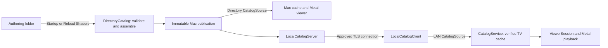
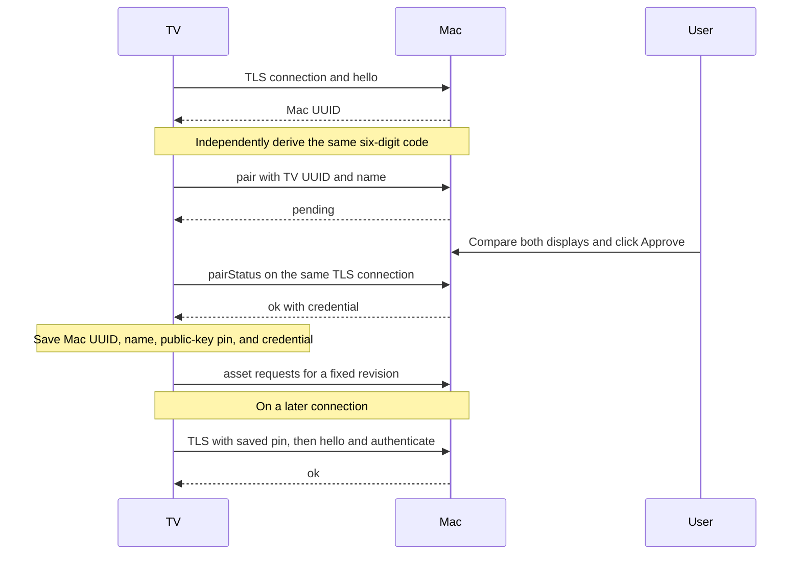

# Local shader serving: technical reference

This guide describes the implementation introduced in PR #14. It is a reference for maintaining the Mac publication service, TV connection, and shared catalog pipeline. For app setup and controls, use [the user quickstart](quickstart.md); for recorded device results and outstanding checks, use [the validation report](local-serving-validation.md).

## Architecture and interfaces

The Mac reads an authoring directory only during publication. Both viewers consume validated, revision-specific assets through `CatalogSource`. The TV obtains those assets from its approved Mac over a native TLS connection. Production TV catalog and preview paths have no URLSession downloader or public-network fallback.



| Component | Responsibility |
| --- | --- |
| `MacLibraryModel` | Own the folder bookmark, startup/manual reload, server lifecycle, and approval UI. |
| `DirectoryCatalog` | Build and restore copied publications; enforce revision asset allowlists and retain leased snapshots. |
| `LocalCatalogServer` | Advertise the service, own TLS identity and approved-TV records, authorize requests, and serve publication bytes. |
| `LocalCatalogClient` | Browse/select a Mac, resolve and connect, pair/authenticate, persist the host pin and credential, and publish connection state. |
| `LocalResolver`, `LocalTrust`, `LocalConnection` | Perform multicast-only resolution, certificate verification, framed exchanges, cancellation, and timeouts. |
| `CatalogService` | Retrieve and validate complete catalogs, coalesce refreshes, atomically cache sources, and independently cache previews. |
| `ViewerSession`, `ShaderCompiler`, `Renderer` | Apply platform playback policy, compile selected Metal sources, and preserve working playback during updates or selection failures. |

The shared request interface is defined in [CatalogSource.swift](../HolodeckCore/Sources/HolodeckCore/CatalogSource.swift):

```swift
enum CatalogRequest: Codable, Sendable, Equatable {
    case head
    case asset(revision: String, path: String)
}

struct CatalogHead: Codable, Sendable {
    let revision: String
}

struct CatalogSource: Sendable {
    var get: @Sendable (CatalogRequest, Int) async throws -> Data
}
```

These excerpts omit access/isolation modifiers and initializers. The second argument to `get` is the caller's byte limit. `.head` returns JSON encoding `CatalogHead`; `.asset` returns the bytes of an allowlisted path at a specified revision. The Mac viewer injects `DirectoryCatalog.source`; TV's live service injects `LocalCatalogClient.shared.source` with `usesLocalNetwork: true`. Offline services and test fixtures use the same catalog/cache pipeline with transfers disabled or injected.

## Authoring and publication

### Input format and assembly

The supported input is the `HolodeckShaders` authoring repository format:

```text
index.json
shared/common.metal
shared/material.metal             # used by material shaders
shared/fragment.metal
shaders/<id>/metadata.json
shaders/<id>/body.metal
```

`index.json` supplies an ordered `shaders` array, an indexed `defaultShaderID`, and optional collections. It must contain 1–500 unique IDs matching `^[a-z0-9]+(-[a-z0-9]+)*$`, each at most 100 characters. Unindexed shaders are ignored.

Each shader's metadata ID must match its directory ID. `shared` must be `["common", "fragment"]` or `["common", "material", "fragment"]`. Assembly concatenates the exact source bytes in this order:

1. `shared/common.metal`
2. `shared/material.metal`, when declared
3. The shader's `body.metal`
4. `shared/fragment.metal`

Source text and attribution comments are preserved. Published entries carry the supported catalog metadata: ID, name, category, description, colors, and optional discovery labels. Collection order and shader membership retain the existing schema. Discovery values use existing normalization and optional-field recovery; keys used only by repository authoring tools are not copied into the catalog.

Bodies implement `float3 shade(float2 p, float time, float2 pixel)`; the shared fragment wrapper calls that function, while helpers provide the vertex/fragment entry points and uniform layout.

Names and descriptions must be nonempty, with limits of 200 and 2,000 characters. Categories are `PROCEDURAL` or `3D MATERIAL`. Colors must be exactly two RGB triplets with finite channel values in 0…1.

The Mac generates previews at 1280×720 and three seconds using the shared offscreen renderer and sRGB target. Successful PNGs are cached in app-owned storage by assembled-source hash, render settings, and renderer version; cache hashes and decoded images are checked before reuse. Legacy `preview.png` and `preview.json` files in the authoring folder are ignored. See [the library workflow](shader-catalog-workflow.md#authoring-format) for cache invalidation and reload behavior.

A shader compilation, GPU render, or PNG encoding failure uses a gradient from its metadata colors and reports a per-shader diagnostic in Settings. Failed renders are retried on reload; successful renders clear the warning. Publication runs no repository scripts, Git commands, Python, or Xcode tools.

### Validation and atomic replacement

`MacLibraryModel` stores `holodeck.shaderFolderBookmark` in its UserDefaults domain. The bookmark uses `.withSecurityScope` and `.securityScopeAllowOnlyReadAccess`; the app holds scoped access while using the selected folder. A stale bookmark is refreshed after a successful reload. A bookmark that cannot be resolved requires folder selection again.

`DirectoryCatalog.reload(from:)` stages the candidate in app-owned storage, verifies that resolved authoring paths remain within the selected root, assembles bounded UTF-8 sources, validates all indexed metadata, and generates previews. Errors for authoring files include the relative path. Candidate failures leave the current served revision available.

Preview generation checks Metal syntax and pipeline creation for uncached sources. Render failures produce preview warnings without rejecting an otherwise valid catalog. Viewer activation compiles the selected source independently; an activation failure retains working playback according to `ViewerSession` policy.

For a valid candidate, the actor installs the staged publication into its revision directory, atomically writes `current.json`, then updates its in-memory revision and allowlist. An existing revision is reused only when its manifest matches the candidate and all copied sources and previews satisfy their size limits and hashes. Missing or corrupt copied assets are repaired by an atomic, same-volume directory swap; an unsupported or failed swap leaves the existing directory and current marker intact. Requests read copied assets, so later authoring edits cannot alter already published bytes. There is no folder watcher: the authoring directory is loaded at startup and on **Reload Shaders**.

Startup first attempts to restore the copied publication after resolving the saved bookmark, then reloads the authoring folder. The restored manifest, sources, and preview hashes are checked. A valid restored library can continue serving if the subsequent authoring reload fails.

### Revisions and retention

For each shader, `updatedAt` is the latest modification time of its metadata, body, and declared helpers, formatted as a timezone-bearing ISO-8601 timestamp. A preview-only edit changes its preview hash and publication revision without advancing that shader's update date.

Revision calculation uses the validated/sanitized manifest encoded with sorted JSON keys, removes `sourceRevision`, and hashes the canonical JSON with SHA-256. Asset SHA-256 hashes and update dates are part of that metadata; array order remains significant. The resulting lowercase 64-character digest becomes both manifest `sourceRevision` and publication revision. It is independent of Git history.

Reading `.head` through the server leases the current revision to that connection. Retention keeps the current publication, the previous publication, and all connection-leased revisions. Reload and connection cleanup trim other revision directories. Closing a connection releases its lease. Retention is not an archive of every past publication.

### Persistent storage

Paths below are relative to the platform's sandbox-resolved directories, rather than fixed home-directory paths.

| Location | Contents |
| --- | --- |
| Mac Application Support: `Holodeck/LocalCatalog/current.json` | Current revision marker. |
| Mac Application Support: `Holodeck/LocalCatalog/<revision>/` | `catalog.json`, `sources/<id>.metal`, and `previews/<id>.png`. |
| Mac Application Support: `Holodeck/LocalViewerCache/` | Viewer `snapshot.json` and preview cache files. |
| TV Caches: `ShaderCatalog/` | Validated `snapshot.json` and `preview-<sha256>.png` files. |
| Mac UserDefaults | Scoped authoring-folder bookmark and viewer preferences. |
| Keychain service: `me.haroldmartin.Holodeck.local-network` | Mac identity/approvals and TV identity/pairing records, described below. |

Implementation: [DirectoryCatalog.swift](../HolodeckCore/Sources/HolodeckCore/DirectoryCatalog.swift), [Mac folder/settings ownership](../HolodeckMac/ShaderLibrarySettings.swift), and [CatalogService.swift](../HolodeckCore/Sources/HolodeckCore/CatalogService.swift).

## Discovery, selection, and lifecycle

The Mac uses `NWListener` on a system-assigned TCP port and advertises `_holodeck._tcp` in Bonjour's `local.` domain. The service instance is `Holodeck <Mac UUID>`; its TXT records are:

| Key | Value |
| --- | --- |
| `id` | Persistent Mac UUID. |
| `name` | Mac computer display name, limited to 100 characters. |
| `version` | Protocol version as text, currently `1`. |

The TV uses `NWBrowser` with `.bonjourWithTXTRecord`. Results require a valid UUID, the matching service type/domain, and a discovered interface; repeated results are grouped by Mac UUID. With no remembered host, one Mac connects automatically and multiple Macs require selection. A remembered host is selected only if it is present. The client retains cached playback when it disappears and does not silently switch to another Mac. A different TXT protocol version produces the incompatible-server state.

`LocalResolver` runs `DNSServiceResolve` and `DNSServiceGetAddrInfo` with `kDNSServiceFlagsForceMulticast` and the discovered interface index. The SRV hostname must end in `.local` or `.local.`. Numeric addresses come from `getnameinfo(..., NI_NUMERICHOST)`; the client rejects disallowed destinations before constructing `NWConnection` and sets `NWParameters.requiredInterface` to the discovered interface. IPv6 link-local scope is preserved or added from that interface. Resolution advances once from service to address to completion. The first valid service result disposes its lookup before starting the address lookup; creation, cancellation, and disposal stay on one serial queue, with duplicate callbacks and completion attempts ignored.

Allowed production unicast destinations are IPv4 `10.0.0.0/8`, `172.16.0.0/12`, `192.168.0.0/16`, and `169.254.0.0/16`, plus IPv6 unique-local `fc00::/7` and link-local `fe80::/10`. Public addresses, hostname destinations, multicast addresses, and IPv4-mapped IPv6 addresses are rejected. Loopback is allowed only by explicit integration-test configuration. The server independently checks the peer address before accepting a session.

Both targets declare `NSLocalNetworkUsageDescription` and `_holodeck._tcp` in `NSBonjourServices`. The Mac sandbox enables incoming/outgoing connections and user-selected read-only file access. DNS policy denial and POSIX `EPERM`/`EACCES` produce a distinct permission state; other browser errors produce disconnection only when no channel or pairing attempt is viable.

The Mac server starts after a valid library is available, continues with the viewer window closed, stops on quit or sleep, and restarts on wake if the library is ready. Sleep observers belong to the library model independently of the viewer window. The TV starts discovery in the foreground and stops discovery and its connection on backgrounding or scene disconnection. Temporary inactivity pauses rendering while preserving networking and pairing. With no cache, the picker opens to show connection and approval state.

Connection attempts and callbacks carry IDs so superseded work cannot clear a newer connection. Successful authentication increments a connection generation; the TV observes it and requests a forced refresh, which the viewer queues after any existing pass.

Implementation: [LocalDiscovery.swift](../HolodeckCore/Sources/HolodeckCore/LocalDiscovery.swift), [LocalCatalogClient.swift](../HolodeckCore/Sources/HolodeckCore/LocalCatalogClient.swift), and [TV lifecycle/UI](../Holodeck/GameViewController.swift). Apple's [multicast flag documentation](https://developer.apple.com/documentation/dnssd/kdnsserviceflagsforcemulticast) and [local-network privacy guidance](https://developer.apple.com/documentation/technotes/tn3179-understanding-local-network-privacy) provide platform background.

## TLS, approval, and authentication

### Persistent Mac identity and certificate verification

The server creates a P-256 signing key, a persistent UUID, and a self-signed X.509 certificate using Apple's Swift Certificates library. The certificate uses ECDSA with SHA-256, subject/issuer `Holodeck <UUID>`, a validity start one hour before creation, a ten-year lifetime, and a critical non-CA basic constraint. The UUID, private key's X9.63 representation, and DER certificate are saved together as a Keychain generic-password item. A `SecIdentity` is reconstructed for the listener. X509 is a conditional macOS dependency in the shared package.

Both endpoints require at least TLS 1.3. The TV hashes `SecKeyCopyExternalRepresentation` of the peer public key with SHA-256 to obtain its pin. It disables certificate network fetching with `SecTrustSetNetworkFetchAllowed(false)`, uses the basic X.509 policy, and trusts only the presented leaf certificate as its anchor. Certificate validity is evaluated locally. On reconnect, the public-key hash must match the saved pin. The `hello` response's Mac UUID must also match the discovered service UUID.

Discovery callbacks carry a browser generation and increasing sequence, so stale results cannot replace current results. Discovery absence or browser waiting does not interrupt an established channel or in-progress pairing. Transient channel/setup failures retry with exponential backoff from one to 30 seconds when the remembered Mac is still advertised; rejection, pin changes, incompatibility, permissions, and credential-storage failures require their explicit recovery steps. When the remembered Mac is missing, no connection or pairing is viable, and alternatives remain available for five seconds, the TV opens the chooser once per absence episode. Returning Macs cancel that recovery; canceling the chooser suppresses another automatic prompt for the same episode. A different Mac is selected only by an explicit chooser action. Temporary scene inactivity pauses rendering; background/disconnection stops networking and foreground return restarts it.

Initial certificate acceptance permits establishing the TLS channel for pairing. Catalog access still requires approval of the connection-derived code. No catalog manifest, source, preview, or revision lookup is available before authentication.

### Pairing and reconnect sequence



The code uses 32 bytes of TLS exported key material with label `holodeck-pairing-v1`. Both endpoints SHA-256 hash it, interpret the first four hash bytes as a big-endian integer, reduce modulo 1,000,000, and display six digits with leading zeros. The code is derived independently; it is not a `pair` message field.

The TV sends its persistent device UUID and name, then polls `pairStatus` once per second on the same TLS connection. The Mac records the pending connection, device ID, name, and code, with a deadline measured from connection acceptance. **Approve** generates 32 random bytes with `SecRandomCopyBytes`, base64 encodes them, persists an approved record with a SHA-256 hash of the token string, and authorizes that connection. The next successful `pairStatus` delivers the credential once. Unauthenticated connections expire five minutes after acceptance, independent of polling or repeated `hello` requests; successful approval or authentication cancels that deadline. Declining returns `rejected`.

The TV saves the Mac UUID/name, public-key pin, and credential before publishing its connected state. Reconnection verifies the saved pin and sends `authenticate` with the device ID and credential. The server compares its hash with the approved record. Raw credentials are retained in TV Keychain and briefly in Mac memory for delivery; the Mac approval record retains only the hash.

### Keychain records and recovery

| Account | Persisted value |
| --- | --- |
| `mac-library-tls-identity` | Mac UUID, private key bytes, and certificate DER. |
| `mac-library-approved-tvs` | Approved TV IDs/names and credential hashes. |
| `tv-identity` | TV device UUID. |
| `tv-pairing` | Selected Mac UUID/name, public-key pin, and credential. |

All use the service named in the storage table. TV items use `kSecAttrAccessibleAfterFirstUnlockThisDeviceOnly`; Mac uses the classic Keychain. Stable Mac development signing helps keep those items accessible across builds. UI tests use separate `ui-<suite>` namespaces and isolated storage.

**Revoke** persists removal of the approval and cancels matching authenticated sessions. Every asset request checks authorization before and after reading the snapshot. Cached TV content is not erased. On rejection the TV removes the saved token while retaining the selected Mac and pin; older pairing records with required tokens still decode. Declined or revoked access requires a new approved pairing; **Check for Scene Updates** can explicitly retry. A changed pin fails closed, and **Change Mac** followed by selecting that host explicitly requests repair and a fresh approval. Switching to another host likewise requires its own pairing. Only one selected Mac pairing is persisted by the current client.

Implementation: [LocalCatalogServer.swift](../HolodeckCore/Sources/HolodeckCore/LocalCatalogServer.swift), [client pairing](../HolodeckCore/Sources/HolodeckCore/LocalCatalogClient.swift), and [LocalTransport.swift](../HolodeckCore/Sources/HolodeckCore/LocalTransport.swift).

## Protocol v1

This is a sequential request/response protocol over the TLS TCP stream. It is an internal app protocol; these details describe the current implementation rather than a separately supported third-party API. Client exchanges are serialized through a task chain. The server handles one received request and its response at a time; there are no request IDs or multiplexed streams.

### Framing and control fields

```text
+----------------------+-----------------------+-------------------------+
| uint32 big-endian H   | H bytes of UTF-8 JSON | length bytes of payload |
+----------------------+-----------------------+-------------------------+
```

`H` counts encoded JSON-header bytes. The JSON's `length` counts binary payload bytes and excludes the prefix/header. Catalog and revision payloads are UTF-8 JSON; shader payloads are UTF-8 Metal; previews are PNG bytes. Payload bytes follow the header without base64 wrapping. Socket reads use chunks of at most 64 KiB, which do not establish additional protocol frames.

`LocalMessage` has these fields. Every encoded header includes the three required fields; nil optional fields are omitted.

| Field | Type | Meaning |
| --- | --- | --- |
| `version` | Integer | Required; currently `1`. |
| `operation` | String | Required request operation or response `ok`/`pending`. |
| `length` | Integer | Required payload size; control-only messages use `0`. |
| `deviceID` | String | TV UUID for pairing/authentication. |
| `name` | String | TV name when pairing. |
| `token` | String | Credential sent for authentication or delivered after approval. |
| `serverID` | String | Mac UUID returned by `hello`. |
| `request` | Object | Codable `CatalogRequest` for `asset`. |
| `limit` | Integer | Caller byte limit for `asset`. |
| `error` | String | Response error code, when present. |

The sender derives `length` from the payload. The receiver checks the header size, decodes the message, verifies its protocol version and payload bound, then reads exactly the declared payload length. The server rejects requests containing any binary payload.

### Operations and responses

| Request | Inputs | Response behavior |
| --- | --- | --- |
| `hello` | No operation-specific inputs. | `ok` with `serverID`; permitted before approval. |
| `pair` | `deviceID`, nonempty `name` (at most 200 characters). | `pending`; adds a connection-specific Mac approval request. |
| `pairStatus` | Same TLS connection as `pair`. | `pending` while waiting, `ok` with the credential once after approval, or `error: rejected` after decline/expiry. |
| `authenticate` | `deviceID`, `token` (at most 100 characters). | `ok` if the credential hash matches an approval; otherwise `error: revoked`. |
| `asset` | `request`, nonnegative `limit` at most 8 MiB. | Requires authorization. `ok` plus bounded asset bytes, `error: revoked`, or `error: invalidAsset`. |

`request` uses Swift Codable's enum representation: `{"head":{}}` for the current revision and `{"asset":{"revision":"…","path":"…"}}` for revision assets. The server serves only `catalog.json`, `sources/<id>.metal`, and `previews/<id>.png` paths in that publication's validated allowlist. It does not read arbitrary authoring paths or interpret requests as download URLs.

### Representative messages

IDs, credentials, and digests below are illustrative. Header key order is immaterial. These examples show decoded JSON headers; the four-byte prefix still counts the actual encoded header's bytes.

First connection's pairing request, followed by the server's pending response:

```json
{"version":1,"operation":"pair","length":0,"deviceID":"11111111-1111-4111-8111-111111111111","name":"Living Room TV"}
```

```json
{"version":1,"operation":"pending","length":0}
```

After approval, the response to `pairStatus` includes a credential. A later connection sends it in `authenticate` with its TV UUID:

```json
{"version":1,"operation":"ok","length":0,"token":"AAAAAAAAAAAAAAAAAAAAAAAAAAAAAAAAAAAAAAAAAAA="}
```

```json
{"version":1,"operation":"authenticate","length":0,"deviceID":"11111111-1111-4111-8111-111111111111","token":"AAAAAAAAAAAAAAAAAAAAAAAAAAAAAAAAAAAAAAAAAAA="}
```

An authenticated current-revision lookup:

```json
{"version":1,"operation":"asset","length":0,"request":{"head":{}},"limit":65536}
```

Response header and its separate 79-byte payload:

```json
{"version":1,"operation":"ok","length":79}
```

```json
{"revision":"0000000000000000000000000000000000000000000000000000000000000000"}
```

Requests for a source and preview at that revision:

```json
{"version":1,"operation":"asset","length":0,"request":{"asset":{"revision":"0000000000000000000000000000000000000000000000000000000000000000","path":"sources/plasma.metal"}},"limit":1048576}
```

```json
{"version":1,"operation":"asset","length":0,"request":{"asset":{"revision":"0000000000000000000000000000000000000000000000000000000000000000","path":"previews/plasma.png"}},"limit":8388608}
```

The corresponding `ok` response's `length` is the asset byte count and its binary payload is the asset itself. A denied request has an error header and no asset payload:

```json
{"version":1,"operation":"ok","length":0,"error":"revoked"}
```

### Bounds, timeouts, and errors

| Bound | Value |
| --- | --- |
| JSON header / `.head` response | 65,536 bytes (64 KiB). |
| Authoring index/metadata JSON and catalog retrieval | 2,097,152 bytes (2 MiB) per read. |
| Individual helper/body read and assembled source | 1,048,576 bytes (1 MiB). |
| All assembled sources | 16,777,216 bytes (16 MiB). |
| Preview or binary frame payload | 8,388,608 bytes (8 MiB). |
| Indexed shaders | 500. |
| Concurrent server sessions | 16. |
| Resolution, TLS readiness, client exchange, frame-body receive, response send | 30 seconds per bounded operation. |
| Pairing polling / pending approval | Once per second / five minutes. |

An authenticated server connection may remain idle while its peer is healthy. Both endpoints enable TCP keepalive after 30 seconds idle, with three probes 10 seconds apart. A dead peer closes the connection, and the connection loop releases its publication lease after any in-flight catalog read completes. Once that byte arrives, the rest of the frame has a 30-second timeout. Thus authenticated idle sessions are not subject to the transfer timeout. Cancellation cancels the socket; truncated or malformed frames and invalid request shapes terminate processing rather than releasing partial assets.

The client maps `revoked` and `rejected` to the access-rejected state and recognizes `incompatible`. `invalidAsset` fails only the asset request; it preserves the connection and its generation. Unknown response errors and malformed frames terminate the connection. A frame version mismatch raises incompatibility directly. The UI distinguishes searching, selection, connecting, approval, connected, disconnected, permission denied, rejected, incompatible, and identity-changed states. Transfer failures retain the previous cache and working renderer; individual preview failures use the preview policy below.

## Catalog refresh, previews, and playback

Catalog errors are formatted for the Mac library or TV connection rather than sharing TV-only instructions. The TV displays catalog failures separately from connection status. Mac renderer alerts do not depend on a configured folder; selection alerts delayed by a reload are retried when it finishes. Cached update failures remain inline.

`CatalogService.current()` validates and restores its disk snapshot before downloads. A refresh retrieves `.head`, accepts lowercase 40- or 64-character revisions, and returns unchanged when the publication revision matches. For a new revision, it retrieves `catalog.json` and then every source sequentially with explicit size limits. It validates manifest structure, source hashes, UTF-8, and total source bytes before atomically writing `snapshot.json` and replacing the in-memory catalog. Previews are fetched separately on demand and do not gate catalog activation.

Concurrent refresh callers share a service-owned operation. Cancelling a waiter ends its wait immediately; the underlying operation can finish and persist even after all waiters leave. Ordinary attempts are throttled for 15 minutes, measured from the last attempt by a monotonic clock, when a usable snapshot exists. Explicit checks and successful connection-generation changes force a refresh. A viewer force request arriving during another pass queues one coalesced forced follow-up; the same returned viewer task completes after all queued passes finish. Viewer shutdown discards queued passes without canceling the service-owned operation. Launch and foreground return also trigger ordinary checks; a foreground reconnect can consequently force one.

Preview requests coalesce by hash and decoded-image size. Validated encoded bytes are cached on disk by hash and in a 16 MiB LRU; decoded images use a 32 MiB LRU. ImageIO runs on a worker queue with two concurrent decodes. Requests use 64-pixel destination buckets and a 2048-pixel cap. Fetches wait up to 30 seconds for connection setup, but approval-required and other actionable states return immediately. Canceling a setup waiter does not cancel shared pairing. Connectivity failures use the optional `CatalogSource.waitForAvailability` hook and retry immediately after authentication succeeds. Other transient failures retry on demand after 30 seconds, doubling to a five-minute ceiling. Validation/decode failures are suppressed for their publication/path/hash until that key changes or the service is recreated. At most 500 failure records are retained. Memory-pressure trimming clears memory caches without deleting disk content; an epoch prevents pre-trim work from repopulating them.

| Policy | TV | Mac |
| --- | --- | --- |
| Startup selection | Last successfully activated ID, otherwise catalog default. | Catalog default. |
| Active source changes in an update | Keep the active pipeline; use revised source on selection or subsequent launch. | Compile and replace changed active source after successful compilation. |
| Metadata-only update | Refresh library metadata without restarting playback. | Refresh metadata without restarting playback. |
| Active shader removed | Existing scene can continue playing. | Existing scene can continue playing. |
| Failed update or selection | Retain working cache and playback. | Retain working cache and playback. |

`ShaderCompiler` caches pipelines by ID and source hash and expects `vertexShader`, `fragmentShader`, and the existing 16-byte buffer-0 uniforms. Selection cancellation/supersession prevents stale results from becoming active. TV saves its last shader ID only after successful activation.

Legacy disk snapshots retain their 40-character revisions and playable sources. The local server does not recreate old remote publications: an uncached preview from an unavailable legacy revision falls back to a gradient without disconnecting the TV. Revocation affects future downloads, not cached playback. tvOS may evict cache files, after which an approved, available Mac is needed to download again.

Implementation: [CatalogService.swift](../HolodeckCore/Sources/HolodeckCore/CatalogService.swift), [ViewerSession.swift](../HolodeckCore/Sources/HolodeckCore/ViewerSession.swift), and [ShaderCompiler.swift](../HolodeckCore/Sources/HolodeckCore/ShaderCompiler.swift).

## Developer setup and testing

### Build and run

Building requires an Apple silicon Mac, Xcode with Swift 6.2 or later and suitable macOS/tvOS SDKs, and resolved Swift package dependencies. The deployment targets are macOS 15 and tvOS 26; they do not establish that every minimum-OS behavior has been physically tested. Source builds and dependency resolution can require internet access; that is separate from the apps' local shader transfers.

1. Open `Holodeck.xcodeproj` in Xcode and select your development team for the app targets. Use an Apple Development identity for the Mac so Keychain access remains stable across rebuilds. Physical TV installation requires a signing identity/profile permitted for that device.
2. Choose the **HolodeckMac** scheme and **My Mac** destination to build/run the Mac app.
3. Choose the **Holodeck** scheme and a compatible TV simulator or paired, awake Apple TV to build/run the TV app.
4. Follow [the quickstart](quickstart.md) to choose the authoring folder and approve the TV. Serving from installed apps requires no Xcode installation or repository publishing tools.

From the repository root, run the portable suite and its optional authoring/LAN checks:

```sh
swift test --package-path HolodeckCore

HOLODECK_LAN_TEST=1 \
HOLODECK_AUTHORING_FIXTURE=/absolute/path/to/HolodeckShaders \
swift test --package-path HolodeckCore
```

App build and test examples:

```sh
xcodebuild -project Holodeck.xcodeproj -scheme HolodeckMac \
  -destination 'platform=macOS,arch=arm64' build

xcodebuild -project Holodeck.xcodeproj -scheme Holodeck \
  -destination 'platform=tvOS Simulator,name=Apple TV 4K (3rd generation)' build

xcodebuild -project Holodeck.xcodeproj -scheme HolodeckMac \
  -destination 'platform=macOS,arch=arm64' -parallel-testing-enabled NO \
  HOLODECK_TEST_BUNDLE_SUFFIX=.RecoveryTests test

xcodebuild -project Holodeck.xcodeproj -scheme Holodeck \
  -destination 'platform=tvOS Simulator,name=Apple TV 4K (3rd generation)' \
  -parallel-testing-enabled NO HOLODECK_TEST_BUNDLE_SUFFIX=.RecoveryTests test
```

Use `xcodebuild -showdestinations` with the relevant project/scheme to select an installed simulator or device when its name differs. Swift Certificates is included only for the Mac target; TV uses Security/Network for TLS verification and credentials.

### Fixtures and physical checks

Core tests inject catalog sources, storage, and clocks. Loopback TLS tests explicitly enable loopback with isolated server identities. `HOLODECK_LAN_TEST=1` enables actual Bonjour browsing, multicast resolution on a private interface, approval, and remembered-client reconnect. `HOLODECK_AUTHORING_FIXTURE` enables native loading/compilation and rendering of a local authoring repository.

UI tests normally inject offline catalog snapshots through `HOLODECK_UI_TEST_CATALOG`. Explicit `--ui-test-storage-suite <suite>` sessions isolate preferences and disk caches. Cleanup launches use `--ui-test-cleanup-storage-suite` to remove that suite and its test credentials, with offline services so cleanup cannot recreate live state. DEBUG-only local-library/LAN flags select real loaders/transports with isolated Keychain namespaces; they retain production address and approval checks when advertising on the LAN.

Mac window-persistence tests terminate the viewer and launch `--ui-test-inspect-preferences` to read saved frame keys through the app's own UserDefaults domain. The inspection view exposes a versioned accessibility snapshot and constructs no viewer, library, or renderer model; it does not autosave a viewer frame. The UI runner never reads the app's container plist directly. Inspection is excluded from Release builds. TV focus tests combine `--ui-test-pending-pairing` with `--ui-test-empty-cache` for a controlled empty local picker without discovery or credentials.

For the opt-in physical TV test, keep a debug Mac validation app running with these launch arguments (set in Xcode's Run arguments or when launching the built app):

```text
--ui-test-storage-suite Holodeck.physical-mac-validation --ui-test-local-library --ui-test-local-network
```

Use the standard `HolodeckShaders` authoring library with `plasma` as its default; this UI test asserts that scene's startup playback. Choose its folder and leave Shader Library settings open. Then run:

```sh
TEST_RUNNER_HOLODECK_PHYSICAL_LAN_TEST=1 \
xcodebuild -project Holodeck.xcodeproj -scheme Holodeck \
  -destination 'platform=tvOS,id=<your-device-id>' -parallel-testing-enabled NO \
  -only-testing:HolodeckUITests/HolodeckUITests/testPhysicalLocalNetworkPairingAndRememberedPlayback \
  HOLODECK_TEST_BUNDLE_SUFFIX=.RecoveryTests test
```

Compare the code printed by the test with the Mac's code and click **Approve**. The test checks downloads, playback, and authentication after relaunch, then cleans its TV credentials/cache. Add `TEST_RUNNER_HOLODECK_PHYSICAL_OFFLINE_TEST=1` to check cached playback after stopping the Mac server when the test prints its offline prompt. Afterward, terminate the Mac validation app and launch it with the same suite and `--ui-test-cleanup-storage-suite` to remove its test state. If several servers are advertising, select the validation host before expecting its pairing request; the test is simplest with only that host available.

See [the validation report](local-serving-validation.md) for dated results and remaining permission-denial, sleep/wake, minimum-OS, and router-level checks. The [workflow guide](shader-catalog-workflow.md) keeps the authoring/publication overview; historical reports are explicitly marked as historical.
